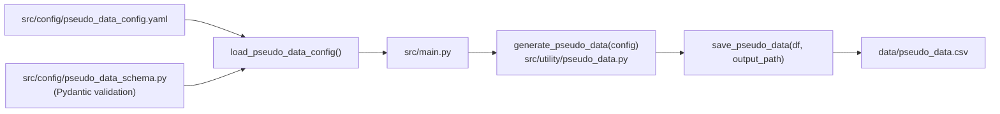

# Pseudo-Data Generator Implementation Plan

## Goal Description

Implement a configurable pseudo-data generator for wafer processing histories and thermal-stress measurements in `src/utility/`, backed by a dedicated YAML configuration and strict Pydantic validation in `src/config/`, invoked from [main.py](file:///d:/git/GGRD-PO/src/main.py) to write `data/pseudo_data.csv`, and verified with a `pytest` suite in `src/test/`.

The generated dataset uses the long-table format defined in [data_example.md](file:///d:/git/GGRD-PO/doc/data_example.md) (`group`, `wafer_id`, `step`, `operation`, `parameter`, `value`), where wafers in the same `group` share an identical recorded process history (repeated experiments) while receiving independent measurement noise and occasional measurement outliers.

---

## Architecture & Data Flow



---

## Proposed Changes

### 1. Environment Dependencies

Install `pydantic`, `pyyaml`, and `pytest` into `.venv` (not currently installed in `.venv`):
- `.\.venv\Scripts\python.exe -m pip install pydantic pyyaml pytest`

---

### 2. Dedicated Configuration (`src/config/`)

Follow `AGENTS.md` §5: YAML is the single source of truth; Pydantic fields define no default values so any missing or unknown key fails validation immediately.

#### [NEW] [__init__.py](file:///d:/git/GGRD-PO/src/config/__init__.py)
Export `PseudoDataConfig` and `load_pseudo_data_config`.

#### [NEW] [pseudo_data_config.yaml](file:///d:/git/GGRD-PO/src/config/pseudo_data_config.yaml)
Dedicated configuration for pseudo-data generation:
- `random_seed: 42`
- `output_path: "data/pseudo_data.csv"`
- `n_groups: 100`
- `wafers_per_group_min: 1`
- `wafers_per_group_max: 5`
- `wafer_id_prefix: "ABC"`
- `wafer_id_digits: 6`
- `total_steps_min: 3` (includes final `measurement` step)
- `total_steps_max: 5`
- `min_depositions: 1`
- `max_treatments: 2`
- `missing_parameter_rate: 0.05` (probability of dropping each droppable numeric parameter)
- `deposition`:
  - `materials`:
    - `TiN`: `["TiN_recipe_v1", "TiN_recipe_v2"]`
    - `TiAlN`: `["TiAlN_recipe_v1"]`
    - `TSN`: `["TSN_recipe_v1", "TSN_recipe_v2"]`
  - `time_min: 60`, `time_max: 600`
  - `temperature_min: 100`, `temperature_max: 1000`
  - `thickness_min: 1`, `thickness_max: 50`
- `treatment`:
  - `recipes`:
    - `anneal`: `["anneal_v1"]`
    - `oxidation`: `["oxidation_v1"]`
  - `time_min: 60`, `time_max: 600`
  - `temperature_min: 100`, `temperature_max: 1000`
- `transition`:
  - `vacuum_break_before_measure: 1`
  - `vacuum_break_values: [0, 1]`
- `stress_model`:
  - `material_constants`: `{TiN: 0.000012, TiAlN: 0.000008, TSN: -0.000015}`
  - `treatment_constants`: `{anneal: -0.0000013, oxidation: 0.0000013}`
  - `noise_std: 0.045`
  - `outlier_rate: 0.05`
  - `outlier_min_abs: 1.5`
  - `stress_min: -10.0`
  - `stress_max: 10.0`
  - `decimal_places: 4`

> [!NOTE]
> **Why these constants balance contributions and hit the target distribution:**
> With `thickness` in `1..50` ($\mathbb{E}[T \cdot d] \approx 14{,}025$) and `treatment` ($\mathbb{E}[t \cdot T] \approx 181{,}500$), Monte Carlo verification over 10,000 samples gives:
> - Deposition RMS contribution: `0.298` (mean $|S_{\text{dep}}| \approx 0.230$)
> - Treatment RMS contribution: `0.310` (mean $|S_{\text{trt}}| \approx 0.223$)
> - Combined signal RMS: `0.427`
> - Noise ratio (`noise_std / combined_RMS`): `0.045 / 0.427 ≈ 10.5%`
> - Normal wafers inside `[-1, 1]`: `~97.7%` (with 5% outliers, ~93% strictly inside `[-1, 1]` and ~95% around `-1~1`, while 100% of wafers lie inside `[-10, 10]`).

#### [NEW] [pseudo_data_schema.py](file:///d:/git/GGRD-PO/src/config/pseudo_data_schema.py)
Pydantic v2 models (`ConfigDict(extra="forbid")`, no field defaults) and `load_pseudo_data_config(config_path: Path) -> PseudoDataConfig`:
- `DepositionConfig`: validates `materials` (non-empty keys and non-empty recipe lists) and `min <= max` for `time`, `temperature`, `thickness`.
- `TreatmentConfig`: validates `recipes` (non-empty keys and non-empty recipe lists) and `min <= max` for `time`, `temperature`.
- `TransitionConfig`: validates `vacuum_break_before_measure` in `{0, 1}` and non-empty `vacuum_break_values` subset of `{0, 1}`.
- `StressModelConfig`: validates `noise_std >= 0`, `0.0 <= outlier_rate <= 1.0`, `stress_min < stress_max`, `outlier_min_abs >= 0`, `outlier_min_abs < min(abs(stress_min), abs(stress_max))` (so both negative and positive outlier intervals are non-empty when `stress_min < 0 < stress_max`), and `decimal_places >= 0`.
- `PseudoDataConfig`: validates `n_groups >= 1`, `0.0 <= missing_parameter_rate <= 1.0`, `wafers_per_group_min >= 1`, `wafers_per_group_min <= wafers_per_group_max`, `total_steps_min >= 2`, `total_steps_min <= total_steps_max`, `min_depositions >= 1`, `min_depositions <= total_steps_min - 1`, `max_treatments >= 0`, and verifies exact key alignment between `deposition.materials` & `stress_model.material_constants`, and between `treatment.recipes` & `stress_model.treatment_constants`.

---

### 3. Pseudo-Data Generator (`src/utility/`)

#### [NEW] [__init__.py](file:///d:/git/GGRD-PO/src/utility/__init__.py)
Export `generate_pseudo_data` and `save_pseudo_data`.

#### [NEW] [pseudo_data.py](file:///d:/git/GGRD-PO/src/utility/pseudo_data.py)
Contains module-level documentation describing the **toy thermal stress model**, outlier/noise behavior, missing-parameter simulation, and long-table schema, plus modular single-responsibility helpers:

1. **Sequence Sampling (`_sample_process_operations`)**:
   - Samples `total_steps` uniformly from `[total_steps_min, total_steps_max]`.
   - Let `n_process_steps = total_steps - 1` (2 to 4 steps; last step is always `measurement`).
   - Computes valid treatment counts $k \in [0, \min(\text{max\_treatments}, n_{\text{process\_steps}} - \text{min\_depositions})]$.
   - Samples $k$ proportional to $\binom{n_{\text{process\_steps}}}{k}$, constructs `["treatment"] * k + ["deposition"] * (n_process_steps - k)`, and shuffles with `rng.permutation` so every valid sequence has equal probability and deposition is not restricted to step 1.
2. **Step Parameter Sampling & Missing Data (`_sample_deposition_step`, `_sample_treatment_step`, `_drop_step_parameters`)**:
   - **Deposition**: samples `material`, samples `recipe` from `materials[material]`, and samples integer `time` (`60..600`), `temperature` (`100..1000`), `thickness` (`1..50`).
   - **Treatment**: samples treatment type (`anneal` / `oxidation`), samples `recipe` from `recipes[treatment_type]`, and samples integer `time` (`60..600`), `temperature` (`100..1000`).
   - **Missing Data Emulation**: After computing the group's true physical thermal stress from the complete generated step parameters, each droppable numeric parameter (`time`, `temperature`, `thickness` for deposition; `time`, `temperature` for treatment) is independently dropped from the emitted group rows with probability `missing_parameter_rate` (`0.05`). `material`, `recipe`, and `transition` rows are always retained, and wafers in the same group share the same recorded (including missing) process history, matching [data_example.md](file:///d:/git/GGRD-PO/doc/data_example.md).
   - **Transition**: appended at the end of every deposition and treatment step (same `step` number, `operation="transition"`, `parameter="vacuum_break"`). Set to `vacuum_break_before_measure` (`1`) when `step == n_process_steps`, otherwise sampled uniformly from `vacuum_break_values` (`0` or `1`).
3. **Toy Thermal Stress Model (`_compute_base_stress`, `_sample_wafer_stress`)**:
   - Deterministic group stress before noise/outliers:
     $$\text{stress}_{\text{base}} = \sum_{i \in \text{depositions}} A_{\text{material}_i} \cdot T_i \cdot d_i + \sum_{j \in \text{treatments}} B_{\text{type}_j} \cdot t_j \cdot T_j$$
   - For each wafer in the group:
     - With probability `1 - outlier_rate` (95%): `stress = clip(stress_base + rng.normal(0.0, noise_std), stress_min, stress_max)`.
     - With probability `outlier_rate` (5%): sample an outlier uniformly from `[stress_min, -outlier_min_abs] ∪ [outlier_min_abs, stress_max]` (weighted by interval width, or symmetric sign choice when bounds are symmetric).
     - Round to `decimal_places`, emitted as `step = total_steps`, `operation = "measurement"`, `parameter = "stress"`.
4. **Public API**:
   - `generate_pseudo_data(config: PseudoDataConfig) -> pd.DataFrame`
   - `save_pseudo_data(dataframe: pd.DataFrame, output_path: Path) -> Path`

---

### 4. Entrypoint (`src/main.py`)

#### [MODIFY] [main.py](file:///d:/git/GGRD-PO/src/main.py)
- Add `main(argv: list[str] | None = None) -> Path` with `argparse`:
  - `--config` (default: `src/config/pseudo_data_config.yaml`, resolved relative to repository root).
  - `--headless` flag (accepted for consistent CLI execution per `AGENTS.md` §1).
- Loads config via `load_pseudo_data_config`, calls `generate_pseudo_data(config)`, saves via `save_pseudo_data(dataframe, output_path)`, and logs the generated group/wafer/row summary.

---

### 5. Tests (`src/test/`)

#### [NEW] [test_pseudo_data.py](file:///d:/git/GGRD-PO/src/test/test_pseudo_data.py)
Unit and integration tests covering:
- Config loading and Pydantic rejection of missing keys, extra keys, inverted min/max bounds, invalid drop/outlier rates, and mismatched `stress_model` keys.
- Exact DataFrame columns and ordering (`group`, `wafer_id`, `step`, `operation`, `parameter`, `value`).
- Group count (`100`), wafer replicates per group (`1..5`), unique `wafer_id`s, identical recorded process/transition rows within each group.
- Step counts (`3..5`), `>= 1` deposition, `<= 2` treatments, deposition allowed after step 1, final step always `measurement` (`stress`).
- Transition row at the end of each deposition/treatment; `vacuum_break == 1` immediately before measurement.
- Material-to-recipe coupling for deposition, treatment recipe membership, and integer bounds on `time`, `temperature`, `thickness` (`1..50`).
- Missing parameter drop behavior (`missing_parameter_rate = 0.0`, `0.05`, and `1.0`), ensuring `material`, `recipe`, and `transition` are never dropped and `stress` remains finite.
- Stress bounds (`100%` within `[-10, 10]`), outlier rate (~5%) and normal concentration (~95% around `[-1, 1]`), exact formula verification when `noise_std: 0.0` and `outlier_rate: 0.0`.
- Determinism with fixed `random_seed`.
- End-to-end `main.py` run writing `data/pseudo_data.csv`.

---

## Verification Plan

### Automated Tests
1. Run unit & integration test suite from repository root:
   ```powershell
   .\.venv\Scripts\python.exe -m pytest src/test/test_pseudo_data.py -v
   ```
2. Run `src/main.py` from repository root in headless mode to generate `data/pseudo_data.csv`:
   ```powershell
   .\.venv\Scripts\python.exe src/main.py --headless
   ```
3. Inspect the generated `data/pseudo_data.csv` header, row count, group count, missing-parameter rate, and stress distribution summary.
